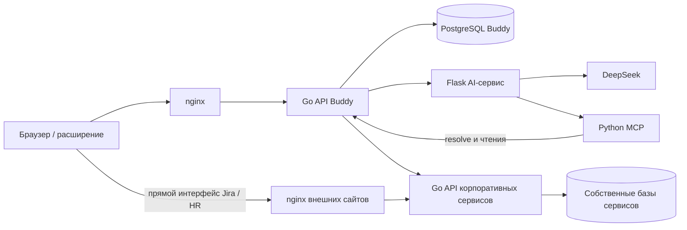
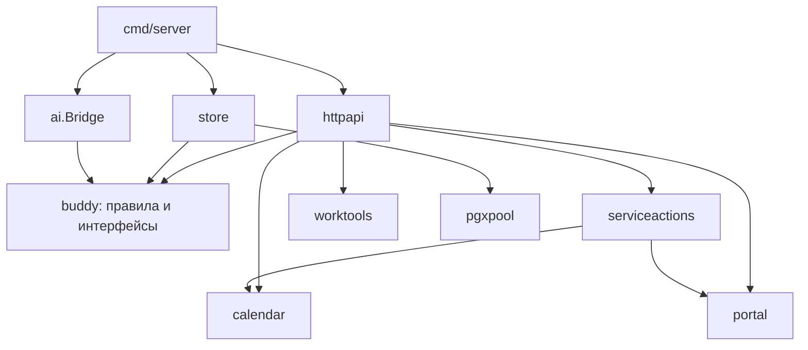
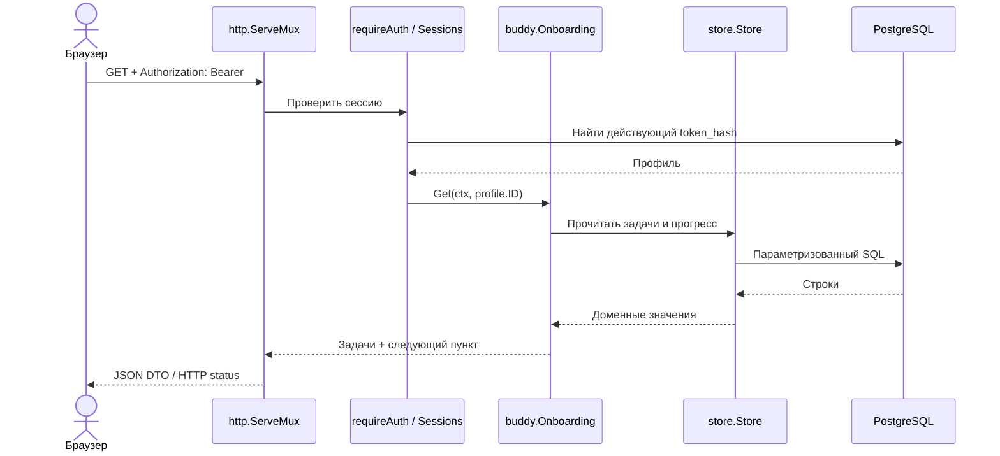
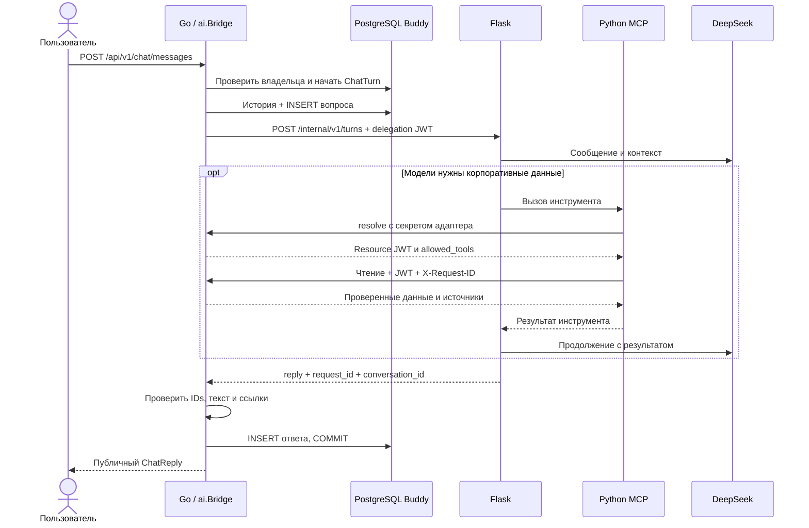
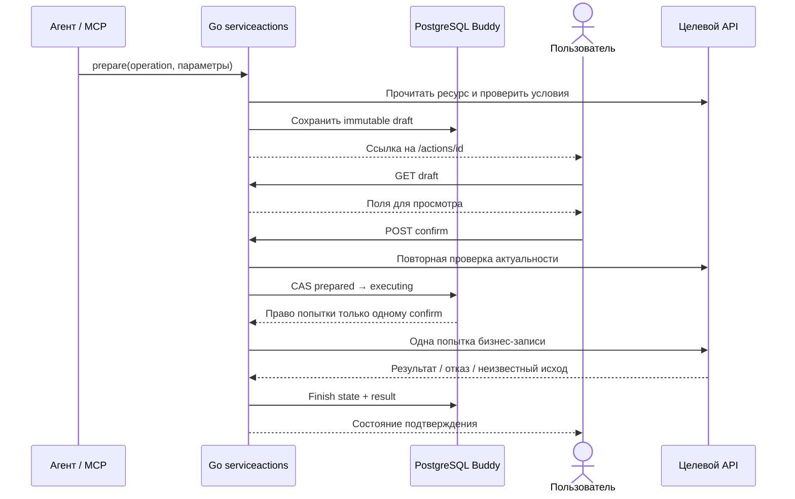
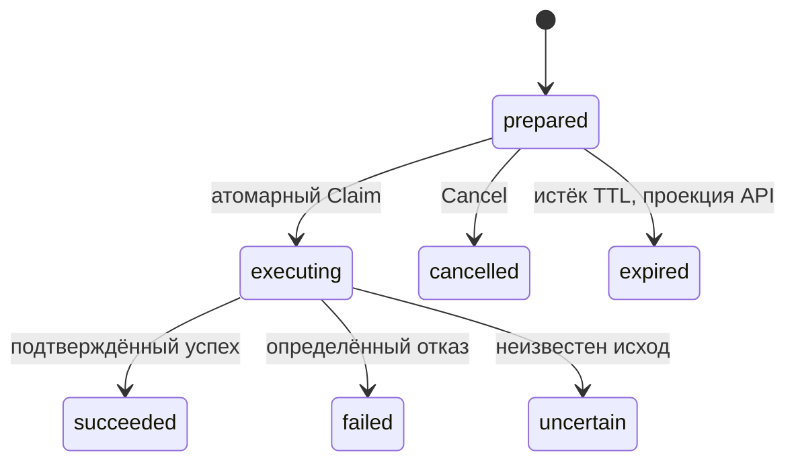
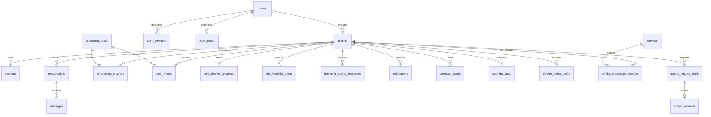

# Go-бэкенд AI Buddy: руководство по реализации

Руководство для разработчика, который хочет понять проект и самостоятельно
менять его. Описывает код `origin/main` на момент подготовки 22 ноября 2026
(базовый коммит `f665966`), включая миграцию `17_team_interns`.
Пути ниже ведут к реализации, а схемы показывают её существенные связи.
Рекомендации по развитию вынесены в [отдельный документ](roadmap.md).

## Содержание и порядок чтения

1. [Ответственность Go и используемый стек](#1-ответственность-go-и-используемый-стек).
2. [Процессы и пакеты](#2-процессы-и-пакеты).
3. [Старт и остановка приложения](#3-старт-и-остановка-приложения).
4. [Жизненный цикл HTTP-запроса](#4-жизненный-цикл-http-запроса).
5. [Сессии и границы доступа](#5-сессии-и-границы-доступа).
6. [Как проходит сообщение чата](#6-как-проходит-сообщение-чата).
7. [Подготовка и подтверждение действий](#7-подготовка-и-подтверждение-действий).
8. [Онбординг, календарь и остальные сценарии](#8-онбординг-календарь-и-остальные-сценарии).
9. [Данные и миграции](#9-данные-и-миграции).
10. [Справочник HTTP API](#10-справочник-http-api).
11. [Внешние Go-сервисы](#11-внешние-go-сервисы).
12. [Практическая работа: запуск, тесты, диагностика и изменение кода](operations.md).
13. [Какие технологии внедрять дальше и зачем](roadmap.md).

Начни с разделов 1–4. Для изменения API затем нужны 5, 9 и 10; для работы
с агентом — 6 и 7. Полные DTO, обязательные поля и ответы находятся в
[OpenAPI](../../contracts/openapi.yaml) и [контракте Go/Python/MCP](../integrations/go-python-mcp.md).
Это руководство объясняет реализацию; контракт конкретного маршрута сверяй
также с обработчиком и его тестами.

## 1. Ответственность Go и используемый стек

Go — доверенная часть приложения. Он определяет пользователя по сессии,
проверяет владельца данных, читает и изменяет PostgreSQL, выдаёт ограниченные
полномочия MCP и отправляет подтверждённые человеком операции в сервисы.
Python отвечает за работу с моделью DeepSeek и выбор инструментов.

Например, просьба «Создай задачу Jira» проходит через модель, но модель
не получает SQL-подключение и не вызывает публичный confirm от имени пользователя.
Go сохраняет черновик, веб показывает его поля, человек подтверждает, и Go
делает попытку записи. При прямом использовании Jira её собственный Go API
обрабатывает создание задачи без обращения к Buddy или модели.

| Технология | Где используется и зачем |
| --- | --- |
| Go 1.26.11 | Компиляция серверов; версия закреплена в `go.mod` и Dockerfile |
| `net/http`, `http.ServeMux` | Сервер, маршруты с методом и параметрами `{id}`, HTTP-клиенты |
| `encoding/json` | Декодирование DTO, сериализация ответов, JSONB-полей |
| `context` | Отмена запросов, дедлайны SQL и исходящих вызовов |
| `pgx/v5` v5.12.0, `pgxpool` | PostgreSQL-драйвер, пул соединений, SQL и транзакции |
| PostgreSQL 17 в Compose | Долговременное состояние, ограничения, блокировки, полнотекстовый поиск |
| `golang-jwt/jwt/v5` v5.3.1 | JWT сессий и делегаций с разными назначениями |
| `log/slog` | События старта и ошибки; централизованная система сбора логов не подключена |
| `testing`, `httptest`, Testify v1.11.1 | Модульные, HTTP- и интеграционные тесты |
| Docker Compose, nginx, GitHub Actions | Запуск процессов, проксирование, проверки и доставка |

Источники версий: [go.mod](../../web/backend/go.mod),
[Dockerfile.go](../../ops/docker/Dockerfile.go), [Compose](../../docker-compose.yml).
ORM, Redis, Kafka, Kubernetes, OpenTelemetry и Prometheus в основном Go API
сейчас не подключены. Учебный инструмент с названием Grafana не является
мониторингом работающего бэкенда.

## 2. Процессы и пакеты

### 2.1. Система целиком



Здесь несколько исполняемых процессов. `web/backend` — основной API Buddy;
`corporate-services/*` и `tools/*` — отдельные учебные системы. Остановка Buddy
не должна делать собственный API Jira зависимым от модели. Карта Compose
и настройки отдельных сервисов приведены в [документации компонентов](../README.md).

### 2.2. Карта основного Go-модуля

| Каталог / файл | Ответственность | Что читать первым |
| --- | --- | --- |
| `cmd/server` | Сборка зависимостей, сервер, сигналы ОС, фоновой worker | [main.go](../../web/backend/cmd/server/main.go) |
| `internal/config` | `.env`, DSN, базовые настройки | [config.go](../../web/backend/internal/config/config.go) |
| `internal/httpapi` | Публичный HTTP, DTO, bearer middleware, ошибки | [api.go](../../web/backend/internal/httpapi/api.go) |
| `internal/buddy` | Модели, правила онбординга/сессий/чата/доступов, интерфейсы зависимостей | [onboarding.go](../../web/backend/internal/buddy/onboarding.go), [chat.go](../../web/backend/internal/buddy/chat.go) |
| `internal/store` | SQL-реализации, хранение истории, review, прогресс | [store.go](../../web/backend/internal/store/store.go) |
| `internal/ai` | Go → Flask, JWT делегации, внутренние MCP-маршруты, evidence и review | [bridge.go](../../web/backend/internal/ai/bridge.go) |
| `internal/serviceactions` | Контекст сервисов, неизменяемые черновики, confirm/cancel, одна попытка | [prepare.go](../../web/backend/internal/serviceactions/prepare.go), [execute.go](../../web/backend/internal/serviceactions/execute.go) |
| `internal/portal` | Каталог доступов, заявки, Confluence, локальные и внешние адаптеры | [service.go](../../web/backend/internal/portal/service.go), [knowledge.go](../../web/backend/internal/portal/knowledge.go) |
| `internal/calendar` | Валидация событий, периоды, HTTP, PostgreSQL-репозиторий | [calendar.go](../../web/backend/internal/calendar/calendar.go) |
| `internal/worktools` | Каталог рабочих инструментов, чтение записей команды, внешние HTTP-адаптеры | [catalog.go](../../web/backend/internal/worktools/catalog.go), [external.go](../../web/backend/internal/worktools/external.go) |
| `accessapi` | Переиспользуемая сборка самостоятельного портала доступов | [access.go](../../web/backend/accessapi/access.go) |
| `migrations`, `seeds` | Структура БД и демонстрационные данные | [миграции](../../web/backend/migrations), [demo.sql](../../web/backend/seeds/demo.sql) |

В Go каталог `internal` ограничивает импорт этих пакетов извне разрешённого
дерева проекта. Публичный `accessapi` позволяет отдельному сервису использовать
нужную сборку без прямого импорта `internal` из чужого модуля.

### 2.3. Направление зависимостей



Базовое правило `httpapi → buddy ← store` видно, например, в `buddy.Access`:
он принимает небольшой интерфейс хранилища, а `store.Store` удовлетворяет ему
своими методами. Go связывает интерфейс и реализацию по набору методов;
отдельный `implements` не нужен. Тест может передать собственную реализацию.

Это модульное приложение с явным конструктором зависимостей. Не все правила
вынесены в `buddy`: `portal`, `calendar`, `serviceactions` содержат собственную
логику и HTTP-регистрацию. Описание «весь код разделён только на три пакета»
для текущей версии неполно. DI-контейнер и генератор зависимостей не используются.

## 3. Старт и остановка приложения

Точка входа — `cmd/server/main.go`; порядок сборки важен при диагностике.

1. `signal.NotifyContext` связывает остановку с SIGTERM и interrupt.
2. `config.Load()` находит настройки и проверяет DSN, секрет и TTL сессии.
3. `pgxpool.ParseConfig` и `NewWithConfig` создают пул; `Ping` проверяет БД.
   `MaxConns` поднимается минимум до 4, но не фиксируется равным 4.
4. Создаётся `portal.Service`; при заданных URL подключаются внешние API
   доступов и Confluence. `EnsureSeed` подготавливает встроенные справочники.
5. Собираются `serviceactions`, календарь, основной `Store`, токены, сессии,
   онбординг, доступы, уведомления и чат.
6. При непустом `AI_SERVICE_URL` создаётся `ai.Bridge`, проверяются origins
   интеграций и разделение ключей, подключаются маршруты MCP и review.
   Без URL используется `UnavailableAssistant`: чат возвращает `503`.
7. При `DEMO_MODE=true` и `WORK_TOOLS_ENABLED=true` подключаются рабочие
   инструменты. `WORK_TOOLS_EXTERNAL=true` выбирает HTTP-адаптеры;
   другой режим использует локальные демонстрационные базы/каталоги.
8. При подключённом bridge запускается worker путеводителя команды.
9. Запускается `http.Server`. Сам сервер миграции не применяет.

| Настройка сервера | Значение в коде |
| --- | --- |
| Адрес по умолчанию | `:8080` |
| `ReadHeaderTimeout` | 5 секунд |
| `ReadTimeout` | 10 секунд |
| `WriteTimeout` | 35 секунд |
| `IdleTimeout` | 60 секунд |
| Graceful shutdown | До 10 секунд на `Server.Shutdown` |

При остановке `Shutdown` прекращает приём новых соединений и ждёт текущие
обработчики в пределах своего контекста. Worker отменяется и ожидается;
пулы закрываются через `defer`. Эти времена — настройки, а не измеренная
скорость ответа. Для чата есть собственный дедлайн 30 секунд, поэтому не стоит
считать 10-секундный shutdown гарантией завершения любого активного AI-запроса.

## 4. Жизненный цикл HTTP-запроса

На примере `GET /api/v1/onboarding`:



Маршрут выбирается стандартным `ServeMux`, включая HTTP-метод и `PathValue`.
Middleware извлекает профиль из bearer-сессии и кладёт его в `context.Context`.
Обработчик преобразует HTTP в вызов сервиса; сервис применяет правила;
хранилище выполняет SQL с `$1`, `$2`, … и возвращает типизированные значения.
Идентификатор владельца для обычного пользовательского чтения берётся
из аутентификации, а не из произвольного поля JSON.

DTO может отличаться от доменного типа. Например, `toOnboardingDTO` переводит
`Completed bool` в `status: pending|completed`. Публичные поля формируются
явно, а не сериализацией SQL-строки целиком.

### Ошибки и декодирование

[httpx.go](../../web/backend/internal/httpapi/httpx.go) переводит ошибки `buddy`
через `errors.Is`, поэтому обёртка `fmt.Errorf("…: %w", err)` сохраняет смысл.

| Ошибка | HTTP | `code` основного httpapi |
| --- | --- | --- |
| `ErrInvalidInput` | 400 | `invalid_input` |
| `ErrUnauthenticated` | 401 | `unauthenticated` |
| `ErrForbidden` | 403 | `forbidden` |
| `ErrNotFound` | 404 | `not_found` |
| `ErrStaleChecklist` | 409 | `stale_checklist` |
| `ErrExpiredDraft` | 409 | `expired_draft` |
| `ErrUnavailable` | 503 | `unavailable` |
| Другая ошибка | 500 | `internal` |

Основной `httpapi.decodeJSON` ограничивает тело 1 MiB и запрещает неизвестные
поля. Он читает один JSON-объект без дополнительной проверки EOF. Декодеры
внутреннего AI API, календаря и действий имеют свои меньшие лимиты и проверки.
Единого формата ошибок для всех пакетов пока нет: например, календарь
возвращает `http.Error`, внутренний AI API использует собственные коды
в верхнем регистре. Клиенту следует опираться на контракт конкретного маршрута.

## 5. Сессии и границы доступа

### Пользовательская сессия

`POST /api/v1/demo/sessions` доступен только при `DEMO_MODE=true`.
Он проверяет существование профиля, выпускает JWT HS256 с `sub`, `iat`, `exp`
и сохраняет SHA-256 полного токена в `sessions.token_hash`.

На следующем запросе `Sessions.Authenticate` проверяет подпись, алгоритм,
наличие срока и `sub`, затем ищет действующую запись сессии по хешу.
Таким образом, одной корректной JWT-подписи недостаточно для доступа без
соответствующей записи в БД. В этой таблице сырой bearer-токен не хранится.

Это демонстрационный вход по `profile_id`. Корпоративного SSO, входа по паролю
и refresh-token flow в данном механизме нет. Подробности:
[tokens.go](../../web/backend/internal/buddy/tokens.go),
[sessions.go](../../web/backend/internal/buddy/sessions.go),
[SQL сессий](../../web/backend/internal/store/sessions.go).

### Разные токены решают разные задачи

| Токен / ключ | Кому предназначен | Проверка и граница |
| --- | --- | --- |
| Пользовательский JWT / `SESSION_SECRET` | Публичный Buddy API | Подпись + `sessions` + срок |
| `AI_SERVICE_TOKEN` | Go → Flask | Сервисная авторизация вызова модели |
| `MCP_ADAPTER_SERVICE_TOKEN` | Python MCP → Go resolve | Отдельный секрет адаптера, constant-time compare |
| Delegation JWT / `AI_DELEGATION_SECRET` | Python MCP | `aud=mcp-delegation`, subject, request, conversation, TTL 1 минута |
| Resource JWT | Внутренние чтения Go | `aud=mcp-resource`, срок и совпадение `X-Request-ID` |
| Staff JWT | Старый сценарий mentor review | `aud=staff-review`, отдельная проверка закреплённых стажёров |
| JWT для Jira / HR / access / work tools | Соответствующий внешний API | Настройки и audience конкретного адаптера |

Delegation и resource JWT подписываются одним ключом делегаций, но имеют
разные audience. Go меняет audience при resolve и не выдаёт таким токенам
пользовательскую сессию. Ключ делегаций должен отличаться от `SESSION_SECRET`.
Секреты межсервисных соединений задаются отдельно; реальные значения в Git
не хранятся.

### Проверка прав после входа

Аутентификация отвечает «кто это», авторизация — «что ему разрешено».
Владение диалогом проверяется в SQL; каталог и знания ограничены продуктом;
Jira проверяет членство пространства/доски; черновик принадлежит профилю.
Перед подтверждением действия доступность и условия проверяются ещё раз.

Не смешивай две модели кабинета наставника:

- Ролевой чек-лист работает через обычную сессию профиля с ролью
  `Наставник`/`Руководитель`; целевые стажёры выбираются по `TeamID`.
- Review учебного задания `consent-news` имеет отдельные staff endpoints
  и JWT `staff-review` в `internal/ai/review.go`.

`page_context.selection` включает подписанный `read_only`; подготовка записи
для такого запроса запрещается и во внутреннем Go API. Контекст страницы
и snapshot чек-листа не выдают новые права. Сохранившийся маршрут
`POST /internal/v1/ai/access/requests` для прямой записи из MCP сейчас
отклоняется; агент должен готовить подтверждение через `serviceactions`.

## 6. Как проходит сообщение чата

### 6.1. Последовательность вызовов



`buddy.Chat.Ask` проверяет длину и непустой текст, selection/checklist и URL.
Из URL страницы удаляются query и fragment, userinfo запрещён. Go не загружает
произвольный DOM по переданному адресу.

Bridge создаёт `request_id`, подписывает делегацию и передаёт историю,
`conversation_id`, сообщение и допустимый контекст в Flask. Профиль уже связан
с токеном; модель не выбирает `subject_id`. Для вопросов о расписании bridge
может добавить подготовленный `hr_today` из HR-интеграций.

Ответ Flask проверяется: оба ID должны совпасть, текст непустой и не длиннее
4000 символов, ссылок не более пяти, их адреса проходят проверку. Только затем
ответ становится публичным `ChatReply`. При ошибке модели нет подстановки
выдуманного успешного результата.

### 6.2. История и конкурентные запросы

Реализация: [store/chat.go](../../web/backend/internal/store/chat.go).
Для существующего диалога SQL `SELECT … FOR UPDATE` блокирует его строку.
Читаются последние 20 сообщений, они разворачиваются в хронологический порядок,
затем добавляется текущий вопрос и вызывается функция генерации.

**В текущем коде транзакция и блокировка удерживаются во время ожидания Flask.**
Это сериализует одновременные сообщения одного диалога, но занимает соединение
пула на время модели. Если генерация завершилась ошибкой, код пытается сохранить
вопрос и `updated_at` без ответа Buddy и возвращает ошибку. При отменённом
контексте или ошибке commit сохранение не гарантируется: SQL тоже может
завершиться ошибкой. Существующая история читается только владельцем.

Store дополнительно ограничивает одновременно вошедшие chat turns каналом:

```text
chatSlots = max(1, min(8, MaxConns - 2))
```

Идея — оставить соединения для обратных MCP-запросов. Это локальный лимит
одного процесса, не глобальный лимит кластера. Ожидающие того же conversation
тоже могут занять слот. Это важная зона для измерения перед масштабированием;
план изменения транзакционной модели описан в [развитии](roadmap.md).

### 6.3. Внутренние полномочия MCP

Resolve проверяет секрет адаптера и делегацию, ещё раз проверяет профиль
и выдаёт ограниченный resource JWT с исходным сроком. `allowed_tools` зависит
от подключённых интеграций и режима read-only.

Каждый внутренний ресурсный обработчик проверяет audience, срок токена,
`X-Request-ID`, профиль и входные аргументы. Полезная нагрузка проходит
через закрытый набор операций; произвольный HTTP URL или SQL от модели
не выполняется. Взаимодействие описано в
[контракте](../integrations/go-python-mcp.md), а фактическая регистрация —
в [Bridge.Register](../../web/backend/internal/ai/bridge.go).

## 7. Подготовка и подтверждение действий

### 7.1. Общий механизм `serviceactions`

Черновик содержит владельца, запрос, сервис, operation, неизменяемый payload,
поля для просмотра, fingerprint, срок, состояние и результат.
Fingerprint — SHA-256 от операции и сериализованных параметров; это ключ
дедупликации, а не авторизация и не шифрование payload.

| Операция | Сервис и результат |
| --- | --- |
| `refer_candidate` | Найм: рекомендация кандидата |
| `set_exit_step` | Завершение работы: отметка пункта |
| `save_exit_draft` | Завершение работы: сохранение черновика даты |
| `request_benefit` | Бенефиты: заявка на выбранный бенефит |
| `create_jira_issue` | Jira: новая задача |
| `update_jira_issue` | Jira: изменение с проверкой version |
| `request_access` | Портал: заявка из доступного каталога |
| `create_calendar_event` | Календарь Buddy: личное событие |

`Prepare` проверяет параметры и доступность ресурсов. `PGStore.Save` использует
транзакционную advisory-блокировку по профилю и fingerprint, чтобы параллельные
подготовки не создали конкурирующие подтверждения одного действия. Кроме этого
есть `UNIQUE(profile_id, request_id, fingerprint)`.



Открытие карточки не отправляет операцию. Публичный confirm принимает
`{"confirm":true}`, cancel — `{"confirm":false}`; другое значение или неизвестное
поле отклоняется. Confirm использует сохранённый payload,
а не новые параметры из браузера. CAS — условный `UPDATE` только из `prepared`
и только до истечения TTL. Параллельный confirm без права попытки читает состояние.
Перед CAS повторно вызывается `plan`, поэтому старые цена, бюджет, членство
или версия Jira могут отклонить действие ещё до записи.

### 7.2. Состояния и неясный результат



TTL нового черновика — 10 минут. `expired` вычисляется в публичной проекции,
а не является состоянием из CHECK-ограничения таблицы. Зависший `executing`
старше 30 секунд тоже показывается как `uncertain`; чтение само по себе
не исправляет такую строку в БД.

При timeout/разрыве сеть может потерять ответ уже после записи в сервисе.
Поэтому `uncertain` не означает «ничего не произошло» и не вызывает повторный
POST. Подтверждение нужно проверить в целевом сервисе. Это гарантия одной
попытки отправки для данного черновика, а не распределённая exactly-once.
После отмены запроса Go использует ограниченный отдельный контекст до 3 секунд
для сохранения результата `Finish`.

У Jira изменение дополнительно перечитывает задачу, сверяет version и объединяет
только заданные changes с существующими полями. Сам API Jira также проверяет
версию при UPDATE. Конфликт не должен затирать чужое изменение.

Подробности: [service-actions](../components/service-actions.md),
[execute.go](../../web/backend/internal/serviceactions/execute.go),
[repository.go](../../web/backend/internal/serviceactions/repository.go).

### 7.3. Два других механизма доступа

В коде есть отдельные пути, которые нельзя описывать как один и тот же автомат:

| Путь | Хранение и гарантия |
| --- | --- |
| Исходный `/access-requests/drafts/{id}/confirm` | `buddy.Access`, `access_request_drafts`, `access_requests`, SQL-мок операции; TTL 15 минут, одна заявка на draft |
| Портал `/portal-access/requests` | Каталог, роль, ресурс, operation key; отдельная модель submitted/approved и решений |
| Доступ через агента | `serviceactions.request_access` готовит и подтверждает вызов портала |

Первый путь вызывает `Corporate.TryExecute` с ключом ID черновика;
`mock_service_operations.operation_key` и `access_requests.draft_id UNIQUE`
делают повтор идемпотентным. Существующая заявка возвращается раньше проверки
истечения. `CORPORATE_MOCK_FAIL` относится именно к этому SQL-моку и не имитирует
отказ всех внешних HTTP API. Сохранённая заявка портала не означает выдачу
настоящего доступа к корпоративной системе.

## 8. Онбординг, календарь и остальные сценарии

### 8.1. Два представления задач

`GET /onboarding` читает каталог `onboarding_tasks` и отметки
`onboarding_progress`, возвращает следующий незавершённый пункт.
Учебное `consent-news` нельзя закончить обычной отметкой — нужен review.

Серверный ролевой чек-лист имеет собственную модель:

- Базовые пункты и начальные демоотметки встроены в
  [role-checklist.json](../../web/backend/internal/buddy/role-checklist.json).
- `role_checklist_progress.completed_ids` хранит отмеченные обычные пункты
  профиля. Отсутствие строки отличается от явно сохранённого пустого массива.
- Выполнение пункта-анкеты определяется настоящей записью
  `internship_survey_responses`, а не произвольным `done=true`.
- `role_checklist_extras` хранит дополнительные задания наставника и их `done`.
- `ChecklistSnapshot` объединяет источники и считает total/percent;
  кабинет наставника получает те же серверные данные.

При `current_only=true` сервер разрешает отметить только актуальный первый
незавершённый базовый пункт. Если UI устарел, возвращается `stale_checklist`.
Изменения массива отметок сериализуются блокировкой `profiles … FOR UPDATE`,
включая самое первое сохранение. Наставник/руководитель добавляет и удаляет
дополнительные задания только у стажёров своей команды; стажёр отмечает свои.

Миграция 17 добавляет восемь стажёров к командам основных профилей
`olga`, `sasha`, `timur`, `maria`. Поэтому список команды уже не ограничен
одним стажёром. Демоданные новых профилей и прогресс смотри в миграции и
встроенном ролевом плане; даты и проценты не зашиты в это руководство.

### 8.2. Оценка знаний и решение наставника

Для `consent-news` Go получает evidence и его версию из сервиса,
создаёт evaluation, вызывает Flask assessment и проверяет ответ: IDs,
версии, SHA-256 ответа, обязательный manual review, критерии и рекомендацию.
Рекомендация модели не завершает задание сама.

Наставник отправляет отдельное решение. В `store/review.go` транзакция
блокирует review, сверяет актуальность evaluation/evidence, сохраняет решение
и completion вместе. Это конкретный учебный процесс, а не общий workflow engine
для любых заданий. Контракт: [оценка знаний](../integrations/knowledge-assessment.md).

### 8.3. Анкеты и уведомления

Ответы анкеты сохраняются по `(profile_id, stage)` через
`ON CONFLICT DO NOTHING`: повтор не переписывает первую отправку.
Схема ответов проверяется в `buddy/surveys.go`. API завершённых этапов
возвращает только сохранённые анкеты.

Уведомления ограничены профилем; `read_at` отмечает прочтение.
Напоминание об анкете скрывается после её завершения. Процент прогресса
и наличие напоминания вычисляются из серверных данных, а не из ответа LLM.

### 8.4. Личный календарь

`calendar.Service` проверяет событие и нормализует время в UTC; календарные
периоды для агента считаются относительно фиксированного UTC+3 (Москва).
Диапазон дат пользователя превращается в полуоткрытый интервал `[from, to)`.

| Ограничение | Текущее значение |
| --- | --- |
| Название | До 120 символов, непустое |
| Описание | До 4000 символов |
| Виды | `Встреча`, `Созвон`, `Напоминание` |
| Импорт / активные события | До 500 |
| Годы | 2000–2100 |
| Диапазон чтения агента | До 366 включительных календарных дней |

Ключ события — `(profile_id, id)`. `PGStore.begin` сериализует операции
advisory-блокировкой на профиль и создаёт демособытия один раз при первой
инициализации `calendar_state`. Удаление использует tombstone `deleted`,
поэтому удалённый сид не появляется вновь. Импорт старых браузерных записей
имеет отдельный признак `imported` и транзакционную обработку.

Прямой PUT/DELETE в вебе действует от сессии владельца. Создание через агента
проходит через черновик с подтверждением. API списка веба и чтение периода MCP
используют общее хранилище, но имеют разные интерфейсы.

### 8.5. Знания, внешние инструменты и путеводитель

`portal` проверяет identity/product/роль, фильтрует доступные ресурсы
и страницы. Локальное чтение Confluence использует SQL, внешний режим —
типизированный HTTP-клиент. Локальный поиск уже использует PostgreSQL FTS:
`to_tsvector('russian', …)`, `websearch_to_tsquery` и `ts_rank`.
Список страниц использует `ILIKE`. Векторная база и embeddings для этого
механизма не обязательны и сейчас не подключены.

`worktools` строит каталог и проекцию записей команды. Внешний режим проверяет
команду ответа, ограничивает время и размер HTTP, не следует redirects.
Общая запись инструмента не становится доступной только из-за того, что
модель назвала его slug.

Путеводитель команды использует таблицу `team_guides` как очередь задания.
Worker раз в секунду пытается получить работу через
`FOR UPDATE SKIP LOCKED`, ставит lease на 60 секунд и увеличивает attempt.
Генерация выполняется после этого SQL-запроса, без длительной открытой
транзакции. Результат сохраняется только для того же attempt; старый worker
не должен перезаписать результат нового. На одну попытку worker даёт
35 секунд. Без подключённого AI bridge этот worker не запускается.

## 9. Данные и миграции

### 9.1. Связи основной БД



Диаграмма показывает ключевые связи Buddy; не все колонки и вспомогательные
таблицы. `portal_access_requests`, `portal_resources`, `confluence_pages`
дополнительно задают каталог/знания в локальном режиме. При HTTP-интеграциях
источником бизнес-данных становятся собственные БД внешних API.
Между PostgreSQL разных сервисов нет обычных foreign keys.

### 9.2. Все применяемые миграции

Файлы в [migrations](../../web/backend/migrations) применяются в лексикографическом
порядке. Номер `08` используется двумя разными файлами; трекер Compose хранит
полное имя, поэтому это два самостоятельных изменения.

| Имя без `.up.sql` | Назначение |
| --- | --- |
| `01_identity` | Команды, профили, участники, сервисы, права, сессии |
| `02_onboarding` | Базовые задачи и прогресс |
| `03_access_requests` | Черновики/заявки, SQL-мок, последовательность номеров |
| `04_chat` | Диалоги и сообщения |
| `05_notifications_and_guides` | Уведомления, страницы-подсказки, статьи |
| `06_consent_task` | Учебное задание согласий |
| `07_task_reviews` | Оценка и решение наставника |
| `08_guide_services` | Задания, action_url и знания документов/мероприятий |
| `08_team_guide` | Brief команды и фоновые генерации |
| `09_access_knowledge` | Роли, каталог портала, заявки и Confluence |
| `10_access_status_guides` | Инструкции по статусам доступа |
| `11_service_actions` | Сохранённые подтверждения операций |
| `12_internship_surveys` | Анкеты и `notifications.read_at` |
| `13_access_service_actions` | Доступ как сервис подтверждённого действия |
| `14_calendar` | Календарь и календарные подтверждения |
| `15_role_checklist` | Сохранённые отметки ролевого плана |
| `16_role_checklist_extras` | Дополнительные задания |
| `17_team_interns` | Дополнительные стажёры команд |

`00_bootstrap.sql` создаёт роль/базы для локальной установки и не входит
в цикл `*.up.sql`. `seeds/demo.sql` — начальные данные, отдельно от DDL;
некоторые миграции также содержат изменения демонстрационных данных.
Не рассчитывай, что редактирование старого seed поменяет уже запущенный стенд.

### 9.3. Ограничения и транзакции

Справочные ID часто текстовые (`profile`, `task`, `service`), операционные — UUID.
У календаря ID строковый, допускающий импортированные браузерные ключи.
Даты событий — `timestamptz`; payload/fields/assessment и некоторые ответы — JSONB.
Это выбор под конкретные данные, а не универсальная схема «всё хранить JSON».

| Место | Механизм согласованности |
| --- | --- |
| Сессии | Уникальный SHA-256 токена + срок |
| Исходная заявка доступа | UNIQUE по draft и составной FK владельца/сервиса |
| Портал | Уникальный operation key владельца и индекс активной заявки |
| Чат | Блокировка строки диалога + транзакция + локальные chatSlots |
| Review | Row lock, версии и атомарное completion |
| Ролевой чек-лист | Row lock профиля, затем вычисление новых отметок |
| Календарь | Advisory transaction lock профиля + составной PK |
| Service actions | Advisory lock при dedup + CAS при Claim |
| Team guide | Lease, SKIP LOCKED, номер attempt |

SQL написан вручную. Для транзакции репозиторий может использовать тот же
интерфейс `querier`, передав `pgx.Tx` вместо пула. `defer Rollback` безопасно
закрывает незавершённую транзакцию; после commit повторный rollback игнорируется.
Обязательно закрываются `Rows` и проверяется `Rows.Err()`.
Индексы, CHECK и UNIQUE — часть бизнес-гарантий, а не только оптимизация.

## 10. Справочник HTTP API

Ниже маршруты основного Go API. Префиксы в таблицах сохранены полностью;
свой API Jira описан отдельно. Наличие части маршрутов зависит от сборки
`With…` и настроек, описанных в разделе 3.

### Сессии и основные функции

| Метод и путь | Назначение |
| --- | --- |
| `POST /api/v1/demo/sessions` | Демосессия профиля, 201; только demo mode |
| `GET /api/v1/onboarding` | Базовый список задач и следующий пункт |
| `PUT /api/v1/onboarding/tasks/{task_id}/completion` | Отметить обычное базовое задание |
| `GET /api/v1/onboarding/role-checklist` | Серверный снимок своего/командного ролевого плана |
| `POST /api/v1/onboarding/role-checklist` | Добавить extra наставником, целевой `profile_id` в query |
| `DELETE /api/v1/onboarding/role-checklist/{task_id}` | Удалить extra наставником |
| `PUT /api/v1/onboarding/role-checklist/{task_id}` | Отметка стажёра, `done` и `current_only` |
| `POST /api/v1/onboarding/role-checklist/import` | Перенести старые отметки владельца |
| `GET /api/v1/onboarding/surveys` | Этапы с сохранёнными анкетами |
| `PUT /api/v1/onboarding/surveys/{stage}` | Сохранить первую отправку анкеты |
| `GET /api/v1/notifications` | Уведомления профиля |
| `POST /api/v1/notifications/read` | Отметить доступные уведомления прочитанными |
| `POST /api/v1/chat/messages` | Синхронный ход чата |
| `GET /api/v1/chat/conversations/{conversation_id}` | История владельца |
| `GET/POST /api/v1/onboarding/consent-review` | Состояние / отправка ответа на учебную проверку |
| `POST /api/v1/demo/staff-sessions` | Отдельная демосессия staff review |
| `GET/POST /api/v1/staff/reviews/{profile_id}` | Чтение / решение по review |
| `GET/POST /api/v1/product-guide/team` | Получить / поставить генерацию путеводителя |
| `GET /api/v1/schedule/hr-today` | Чтение текущих отсутствий/поездок через bridge |
| `GET /api/v1/work-tools/{service}` | Записи доступного рабочего инструмента |

### Календарь, доступы и знания

| Метод и путь | Назначение |
| --- | --- |
| `GET /api/v1/schedule/events` | Личные события и `has_more` |
| `PUT /api/v1/schedule/events/{event_id}` | Создать/обновить своё событие |
| `DELETE /api/v1/schedule/events/{event_id}` | Удалить своё событие |
| `POST /api/v1/schedule/import` | Импортировать старые записи |
| `GET /api/v1/access-requests` | Исходный список access requests |
| `POST /api/v1/access-requests/drafts/{draft_id}/confirm` | Подтвердить исходный access draft |
| `GET /api/v1/portal-access/catalog` | Шаблоны и ресурсы доступов |
| `GET/POST /api/v1/portal-access/requests` | Список / отправка заявки портала |
| `POST /api/v1/portal-access/requests/{id}/decision` | Решение/отмена по правилам портала |
| `GET /api/v1/confluence/pages` | Список/поиск доступных страниц |
| `GET /api/v1/confluence/pages/{id}` | Конкретная доступная страница |
| `GET /api/v1/service-actions/{action_id}` | Поля и состояние черновика |
| `POST /api/v1/service-actions/{action_id}/confirm` | Одна попытка после подтверждения |
| `POST /api/v1/service-actions/{action_id}/cancel` | Отмена подготовленного черновика |

### Внутренний адаптер MCP

| Метод и путь | Инструмент / назначение |
| --- | --- |
| `POST /internal/v1/ai/context/resolve` | Делегация → ресурсный токен |
| `POST /internal/v1/ai/knowledge/search` | `search_knowledge` |
| `GET /internal/v1/ai/team-context` | `get_team_context` |
| `GET /internal/v1/ai/onboarding/progress` | `get_onboarding_progress` |
| `POST /internal/v1/ai/onboarding/task-context` | `get_task_context` |
| `POST /internal/v1/ai/onboarding/task-evidence` | `get_task_evidence` |
| `GET /internal/v1/ai/access/catalog` | `get_access_catalog` |
| `GET /internal/v1/ai/access/requests` | `get_access_requests` |
| `POST /internal/v1/ai/access/requests` | Сохранённый маршрут прямой записи; запрещён bridge |
| `POST /internal/v1/ai/knowledge/page` | `get_knowledge_page` |
| `POST /internal/v1/ai/service-context` | `get_service_context` |
| `POST /internal/v1/ai/service-actions/prepare` | `prepare_service_action` |
| `GET /internal/v1/ai/work-tools` | `get_work_tools` |
| `POST /internal/v1/ai/work-tools/context` | `get_work_tool_context` |

Имена/аргументы инструментов сверяются с
[agent-tools.json](../../contracts/agent-tools.json). Сам путь `/internal/`
не заменяет авторизацию и не делает endpoint закрытым автоматически.

## 11. Внешние Go-сервисы

| Исходники | Домен | Где описан контракт |
| --- | --- | --- |
| `corporate-services/absences` | Отсутствия | [HR-сервисы](../components/corporate-services.md) |
| `corporate-services/trips` | Командировки | [HR-сервисы](../components/corporate-services.md) |
| `corporate-services/hiring` | Найм и рекомендации | [HR-сервисы](../components/corporate-services.md) |
| `corporate-services/offboarding` | Завершение работы | [HR-сервисы](../components/corporate-services.md) |
| `corporate-services/consents` | Согласия | [HR-сервисы](../components/corporate-services.md) |
| `corporate-services/benefits` | Бенефиты | [HR-сервисы](../components/corporate-services.md) |
| `corporate-services/documents` | Документы | [HR-сервисы](../components/corporate-services.md) |
| `corporate-services/events` | Мероприятия | [HR-сервисы](../components/corporate-services.md) |
| `corporate-services/access` | Собственный портал доступов | [access-portal](../components/access-portal.md) |
| `tools/jira` | Пространства, доски, задачи | [Jira](../components/jira.md), [OpenAPI](../../contracts/jira.openapi.yaml) |
| `tools/confluence` | Знания | [Confluence](../components/confluence.md) |
| `tools/work-tool` | Один исполняемый модуль для 13 рабочих инструментов | [спецификация](../specs/work-tools-services.md) |
| `tools/shared` | Общая авторизация и HR-подключения | [session.go](../../tools/shared/session.go), [hr.go](../../tools/shared/hr.go) |

Каждый модуль имеет свои правила конфигурации и миграций; корневой
`go test ./...` не объединяет автоматически все вложенные `go.mod`.
Для полного обхода есть `ops/checks/service-go.sh`.

Jira служит показательным примером: её маршруты объявлены в
[main.go](../../tools/jira/main.go), задачи привязаны к доске, доски —
к пространству; SQL проверяет членство. Создание и изменение идут в транзакции
с блокировкой доски. Изменение требует version и увеличивает её; конфликт
возвращает 409. Токен Buddy не считается Jira-сессией: используется отдельная
подпись/делегация. У Jira есть свой `/health`; это не маршрут основного Buddy.

Go HTTP-клиенты используют настроенные сервером origins, ограничение ответа
и времени. Например, `serviceactions.Client` имеет timeout 2 секунды,
отключённые redirects и env proxy, лимит ответа 128 KiB, JWT на 30 секунд.
Bridge к Flask имеет другие настройки: timeout 26 секунд и ответ до 64 KiB.
Не переносите ограничения одного клиента на все интеграции без чтения их кода.

## 12. Словарь основных терминов

| Термин | Значение в этом проекте |
| --- | --- |
| Handler / обработчик | Функция, принимающая HTTP-запрос и формирующая ответ |
| Middleware | Обёртка обработчика, например проверка bearer-сессии |
| DTO | Структура формата запроса/ответа на границе HTTP |
| Use case | Прикладной сценарий: отметить пункт, подтвердить заявку |
| Repository / store | Интерфейс и реализация операций хранения |
| Pool | Переиспользуемый набор соединений PostgreSQL |
| Transaction | Группа SQL-операций с общим commit/rollback |
| Row lock | Блокировка конкретной строки от конкурирующих изменений |
| Advisory lock | Блокировка по выбранному приложением ключу; все участники должны соблюдать правило |
| CAS | Compare-and-swap: изменить состояние только при ожидаемом старом значении |
| Idempotency / идемпотентность | Повтор запроса с тем же ключом не создаёт второй бизнес-результат |
| Lease | Ограниченное во времени право worker выполнять работу |
| TTL | Срок действия сессии, делегации или черновика |
| JWT audience | Назначение токена; другой тип API не должен его принимать |
| ACL / scope | Правила доступа и область данных пользователя/команды |
| Evidence | Проверяемое состояние из сервиса, подтверждающее факт выполнения |
| Projection / проекция | Безопасное представление внутренних данных для API или модели |
| FTS | Полнотекстовый поиск PostgreSQL по словам и их формам |

Далее: [как запускать, тестировать и диагностировать](operations.md),
[как развивать архитектуру](roadmap.md).
