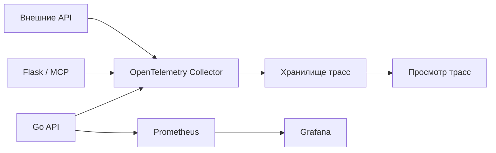
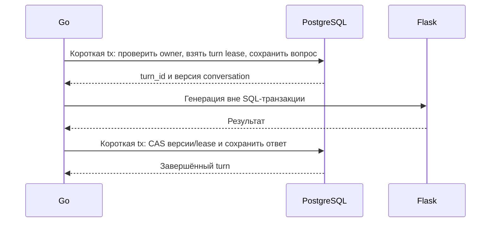

# Go-бэкенд: направления развития

[Реализация](README.md) · [Эксплуатация](operations.md)

Это предложения по текущему коду, а не список уже внедрённых компонентов.
Приоритеты — инженерная оценка: нагрузочный профиль и production SLO пока
не измерены этим документом. Новые зависимости здесь не устанавливаются.
Внешние ссылки ведут на официальные материалы; версии для внедрения нужно
отдельно закрепить в манифестах и проверить в CI.

## 1. Что делать сначала

| Порядок | Изменение | Причина в текущем коде | Как понять, что стало лучше |
| --- | --- | --- | --- |
| 1 | Метрики, трассировка и корректные health endpoints | Сейчас нет общей длительности по этапам, основной health — ожидаемый 401 | Видны ожидание пула, SQL, Flask/MCP и целевого API; readiness отличим от liveness |
| 2 | Короткие транзакции ChatTurn | Модель ожидается под транзакцией и row lock диалога | Под нагрузкой не исчерпывается пул; порядок сообщений и владение сохраняются |
| 3 | Контроль AI-бюджета и параллелизма | chatSlots локален процессу, есть чат, assessment и worker | Лимиты охватывают все платные пути; превышение не вызывает LLM |
| 4 | Единые ошибки и HTTP middleware | Разные пакеты возвращают разные форматы; нет общего request log | Контрактные тесты для ошибок и request/trace ID |
| 5 | SSO и управление жизненным циклом сессий | Demo-вход по profile_id не является корпоративным входом | Проверены подмена issuer/audience, отзыв доступа и роли |
| 6 | SQL и поиск по измеренным узким местам | SQL вручную, FTS вычисляется в запросе, team checklist читается по профилям | EXPLAIN и метрики подтверждают снижение SQL-времени/числа запросов |

Начальный полезный набор — PostgreSQL + существующий pgx, метрики и трассы.
Redis, очередь и оркестратор добавляются после выявления конкретной задачи.

## 2. OpenTelemetry, Prometheus и профилирование

OpenTelemetry Go позволяет инструментировать трассы и метрики. Для проекта
полезен единый контекст Go → Flask → MCP → Go → внешний API, при сохранении
существующего `X-Request-ID` как бизнес-связи. Результат — возможность увидеть,
в каком вызове и ожидании прошли секунды. [OpenTelemetry Go](https://opentelemetry.io/docs/languages/go/).

Prometheus собирает метрики приложения через Go-клиент; Grafana может показывать
панели поверх этих данных. Начать стоит с request duration/count, статусов,
занятых/ожидающих соединений pgxpool, ожидания chatSlots, длительности внешних
вызовов, состояния worker и числа uncertain. Метки должны быть ограничены
маршрутом/операцией/статусом: profile_id, prompt и случайный request_id
не подходят для labels. [Инструментирование Go для Prometheus](https://prometheus.io/docs/guides/go-application/).

Это схема предлагаемого контура. Сейчас такие компоненты в Compose
не запущены. В spans и логах нельзя бездумно сохранять JWT, DSN, тексты
личных диалогов и кадровые payload. Нужны фильтрация и правила хранения.

Для CPU/heap/goroutines можно добавить диагностический `pprof` на отдельный
закрытый listener, включаемый настройкой. Это помогает отличать CPU-проблему
от сетевого ожидания. Публичный `DefaultServeMux` с профилями не должен случайно
попасть на пользовательский порт. [net/http/pprof](https://pkg.go.dev/net/http/pprof).

## 3. Переработка транзакций чата

Увеличение `MaxConns` частично откладывает проблему, но не убирает ожидание
модели под блокировкой. До подключения нового хранилища разумно спроектировать
устойчивый turn как отдельную запись в PostgreSQL:

Это **проект изменения**, не текущая реализация. Необходимо заранее решить:
что ответить второму сообщению того же диалога, как восстановить процесс после
рестарта, как показывать pending turn и как не продублировать платную генерацию.
Простое удаление `FOR UPDATE` потеряет существующую гарантию порядка.

Проверки: два одновременных сообщения одного диалога; разные диалоги;
рестарт до/после ответа модели; timeout; повтор клиентского запроса;
свободный пул для обратных MCP-чтений. Сначала полезен синтетический Flask,
чтобы измерение не зависело от бюджета и задержки настоящей модели.

## 4. SQL: sqlc, индексы и PgBouncer

### sqlc

sqlc генерирует типизированные функции из SQL. Он может уменьшить ручное
сопоставление колонок со `Scan`, сохранив явный SQL и pgx. Начать можно с одного
стабильного репозитория, без одновременной переписи доменной модели.
[Документация sqlc](https://docs.sqlc.dev/en/latest/).

Цена внедрения: конфигурация генерации, фиксация инструмента, generated code
и проверка воспроизводимости в CI. sqlc не заменяет ACL, проектирование
транзакций и тесты уникальных ограничений. Внедрение ORM только ради уменьшения
числа строк SQL не решает эти задачи автоматически.

### Поиск и индексы PostgreSQL

Полнотекстовый поиск в `portal` уже есть. Следующий шаг — измерить планы
и, если требуется, выбрать согласованное выражение `tsvector`/GIN-индекс
или сохранённую поисковую колонку. Индекс должен соответствовать реальному
выражению и фильтрации источников. Сначала нужно разобрать отдельно запросы
к встроенному корпусу и внешнему Confluence.
[Индексы FTS PostgreSQL 17](https://www.postgresql.org/docs/17/textsearch-indexes.html).

Для командного чек-листа стоит измерить количество запросов при росте команды:
текущий обработчик обходит профили и строит snapshot каждого. Возможное
улучшение — пакетное чтение данных команды с прежними правами доступа.
Ни Redis, ни замена HTTP-роутера не устраняют такой обход SQL сами по себе.

### PgBouncer

PgBouncer — дополнительный пул PostgreSQL-соединений между приложениями и БД.
Он полезен, когда число реплик и независимых сервисов превышает доступный
бюджет соединений. У каждого Go-процесса уже есть pgxpool, поэтому вводить
второй слой следует по суммарному расчёту соединений и времени ожидания.
[Возможности и ограничения режимов PgBouncer](https://www.pgbouncer.org/features.html).

Transaction pooling ограничивает session-level возможности; миграционный
`pg_advisory_lock` держится на одной сессии и требует отдельного рассмотрения.
Миграции лучше выполнять по прямому административному соединению. Также
нужно проверить режим prepared statements pgx и транзакционные блокировки.
PgBouncer не сокращает время транзакции, которая ждёт модель.

## 5. Redis: когда он оправдан

Redis даёт быстрые key/value операции и счётчики. Возможные задачи в проекте:
общий rate limit между репликами, короткий кеш справочников и централизованный
бюджет одновременно выполняемых AI-работ.
[Тип Strings и операции Redis](https://redis.io/docs/latest/develop/data-types/strings/).

Перед внедрением нужны ответы на четыре вопроса:

1. Какие данные являются источником истины? Для заявок/черновиков им остаётся PostgreSQL.
2. Какой ключ изолирует пользователя/продукт/версию прав? Общий кеш поиска
   без ACL способен показать чужой документ.
3. Как инвалидируется запись и что происходит при недоступности Redis?
4. Как измеряются hit rate, актуальность и экономия SQL/HTTP?

Не стоит хранить единственную копию подтверждения действия в недолговечном
кеше или подменять CAS PostgreSQL необоснованной распределённой блокировкой.
Для одного процесса сначала можно ввести ограниченный локальный cache,
если измерения показывают повторяемые безопасные чтения. Глобальный AI-бюджет
нужен только при реальном разделении нагрузки между несколькими процессами.

## 6. SSO / OpenID Connect

Перед доступом реальных сотрудников стоит заменить demo-выбор профиля
на корпоративный identity provider. Keycloak — один из вариантов OIDC provider;
при наличии корпоративного провайдера отдельный Keycloak может не понадобиться.
[Keycloak: OIDC endpoints](https://www.keycloak.org/securing-apps/oidc-layers).

Нужно спроектировать mapping внешнего subject в `profiles`, проверку подписи,
issuer/audience/expiry, получение команд/ролей, отзыв прав и поведение при
недоступности IdP. Выданный внешним провайдером токен не следует автоматически
принимать в качестве внутреннего resource JWT MCP.

Граница подтверждения сохраняется: SSO удостоверяет человека, но не превращает
предложение модели в его согласие. Парольный nginx gate учебного стенда тоже
не заменяет авторизацию каждой бизнес-операции.

## 7. Фоновые задания и очереди

Путеводитель уже использует PostgreSQL-очередь с lease и attempt. Сначала стоит
измерить её: число pending/failed, возраст старейшего задания, длительность
и повторные попытки. Следующий шаг может остаться в PostgreSQL: общий job type,
ограниченные retry/backoff, ключ идемпотентности и ручное восстановление.

Если появляется много независимых потребителей событий и нужен replay,
можно рассматривать Kafka как журнал событий. Она предназначена для
публикации/подписки, хранения и обработки потоков событий.
[Apache Kafka: введение](https://kafka.apache.org/intro/).

Для согласованной публикации после бизнес-транзакции сначала проектируют
outbox: запись события в той же БД-транзакции, отдельная доставка и дедупликация
потребителем. Добавление брокера само по себе не создаёт exactly-once
между PostgreSQL, Jira и сетевым запросом. Нельзя переносить неизвестный исход
бизнес-POST в обычный «retry до успеха».

## 8. Kubernetes и дальнейшее масштабирование

Kubernetes управляет контейнерными workload и их развёртыванием.
Он может понадобиться при росте числа узлов, команд эксплуатации и реплик,
но не исправляет медленный SQL или блокировки приложения.
[Обзор Kubernetes](https://kubernetes.io/docs/concepts/overview/).

До миграции Compose нужны: отдельные readiness/liveness, корректный shutdown,
внешние секреты, ресурсные limits/requests, один контролируемый запуск
миграций, backup/restore и расчёт пула на все реплики. PostgreSQL для production
требует собственной стратегии эксплуатации; StatefulSet не заменяет её.

Уже сейчас `chatSlots` ограничивает только один процесс. После добавления
реплик суммарное число модельных запросов возрастёт; ограничения AI-бюджета
и порядок conversation должны работать независимо от выбранного pod.
План масштабирования должен учитывать это раньше включения autoscaling.

## 9. Что полезно улучшить без новой платформы

- Общие request ID, structured access log, recovery middleware и согласованное
  отображение ошибок по контракту.
- Отдельные `/health/live` и `/health/ready`: без модельного вызова, с понятной
  проверкой обязательных зависимостей и коротким таймаутом.
- Пагинация растущих списков, пакетный SQL там, где измерен обход профилей.
- Единые принципы HTTP-клиентов: origins, redirects, size/time budget;
  retries только там, где известна безопасность повторения.
- Аудит «кто подготовил/подтвердил, какой результат» без хранения секретов
  в обычном логе; сроки хранения сессий, сообщений и подтверждений.
- CI-проверка схем и контрактов; воспроизводимые нагрузочные сценарии
  с локальным AI mock и итоговой проверкой БД.

Критерий выбора технологии — конкретная наблюдаемая проблема и тест результата.
Сначала измерения, затем небольшое проверяемое изменение, после него повтор
того же сценария. Проценты ускорения и предел RPS следует публиковать только
после воспроизводимого замера на описанном окружении.
