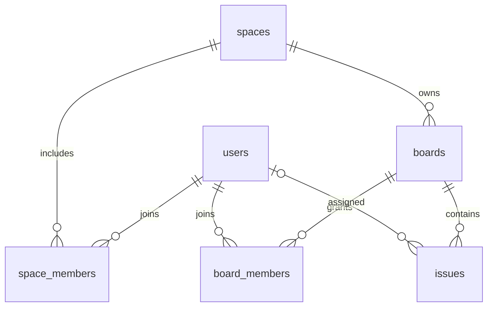

# Jira

Агент читает видимые пространства/доски, свои и выбранные задачи Jira. Создание и частичное изменение требуют ручного подтверждения; версия защищает от перезаписи. [Делегация и настройки](service-actions.md).

Самостоятельный учебный трекер задач: React-интерфейс, Go HTTP API и отдельная
PostgreSQL 17. [Поведение](../specs/005-jira.md), [OpenAPI](../../contracts/jira.openapi.yaml).
Доступ к доскам и задачам определяется сервером по членству, а не скрытием кнопок.

## Запуск

```sh
docker compose --profile hr --profile jira up --build -d
```

AI Buddy: http://localhost:5173, Jira: http://localhost:5189. Карточка Jira
передаёт выбранного стажёра. Прямой вход использует Марию, профиль можно сменить
демопереключателем. Поддержаны Ольга, Александр, Тимур и Мария. Собственные
демосессии Jira не используют сессии AI Buddy; это не production SSO.
Профиль `jira` запускает `jira-db`, одноразовый `jira-migrate` и `jira`.
Без него остальные сервисы работают, Jira показывает ошибку подключения.

База `jira` хранится в отдельном томе `jira-postgres`. `COMPOSE_JIRA_DB_PASSWORD`
и `COMPOSE_JIRA_SESSION_SECRET` задаются в корневом `.env`. Последний минимум
32 символа, отличается от SESSION_SECRET AI Buddy. База не публикует порт наружу.
Миграции применяются через существующий ops/docker/migrate.sh под advisory lock;
сид выполняется один раз и не перезаписывает правки. Смена пароля существующего
PostgreSQL-тома требует ALTER ROLE, как для обычного PostgreSQL.

Локально: применить `tools/jira/migrations/*.up.sql` и `seeds/demo.sql` к
отдельной БД через psql; экспортировать переменные из `.env.example` сервиса;
из `tools/jira` запустить `go run .`. Фронтенд из корня:
`npm run dev --workspace=@ai-buddy/corporate-services -- jira`.
Vite проксирует `/jira-api` в API на 8189; nginx делает то же в Compose.
Адрес карточки задаётся `VITE_JIRA_URL`.

## Связи данных



## Файлы и данные

- `tools/jira/main.go`: HTTP, JWT, валидация, PostgreSQL-запросы и транзакции.
- `migrations/001.up.sql`: пользователи, пространства, участие в пространствах,
  доски, участие в досках, задачи; `001.down.sql` — обратная миграция.
- `seeds/demo.sql`: четыре команды, по три доски (одна закрытая для наставников).
- `frontend/api.ts`: типизированный клиент с Zod, проверка ответов, фильтры.
- `frontend/page.tsx`, `style.css`: выбор пространства/доски, канбан, редактор.
- `main_test.go`: авторизация, валидация и интеграционный сценарий с PostgreSQL.
- `frontend/api.test.ts`: клиент, ошибки, поиск и поля редактора.

Внешний `users.id` совпадает с profile_id Buddy; межбазовых foreign keys нет.
Назначение человека в доску требует членства в пространстве. Исполнитель задачи
может быть NULL. Иначе он обязательно участник этой доски. Изменение задачи
передаёт version; конкурирующая правка получает 409. Браузер хранит токен только
в памяти, после перезагрузки создаёт демосессию заново.

## Проверки

`just jira-check` запускает gofmt, vet и race-тесты. Для интеграционных тестов
нужен `JIRA_TEST_DATABASE_URL` тестовой PostgreSQL: тест создаёт временную схему,
применяет миграцию и сид и удаляет схему при завершении. Без этой переменной
интеграционный тест пропускается; CI job go обязательно задаёт её.
`npm test --workspace=@ai-buddy/corporate-services` включает Jira-тесты;
типизация, ESLint, форматирование и сборка входят в frontend CI и just check.

На главной отдельного списка задач пока нет. MCP-интеграция описана выше. `GET /api/v1/me/issues` возвращает
только назначенные пользователю задачи доступных досок, с ключом, статусом,
сроком и идентификаторами доски/пространства. Это точка расширения для будущей
интеграции. API требует собственный токен Jira; Go выпускает короткий токен с issuer/audience Jira для текущего профиля.

Серверный overlay включает Jira автоматически; CD собирает API, сохраняет
`jira-database.sql.gz` для существующей БД и проверяет nginx gate/session/tasks
на 5189 перед ready. На сервере должны быть доступны порт 5189 и обновлённый
доверенный worker: он установлен root-owned вне release и не обновляется
произвольным исходным кодом PR. Администратор однократно устанавливает новую
версию через ops/deploy/install.sh. После этого слияния запускают Jira
обычным CD. Без обновления установленного worker автоматический запуск нового
API не гарантируется. Серверный overlay использует уже заданные DB/session
секреты как fallback; рекомендуется задать отдельные COMPOSE_JIRA_* до первого
старта. Смену пароля существующего тома нужно выполнять через ALTER ROLE.

## Пояснение выделенного текста

Карточка и редактор задачи передают её UUID в «Уточнить у агента». Для выделения в редакторе доступно текстовое описание, поля формы исключены. Панель читает задачу с прежними правами; смена статуса и другие действия в этом режиме запрещены.

[Сценарий и ограничения](../specs/010-selection-explanation.md).
